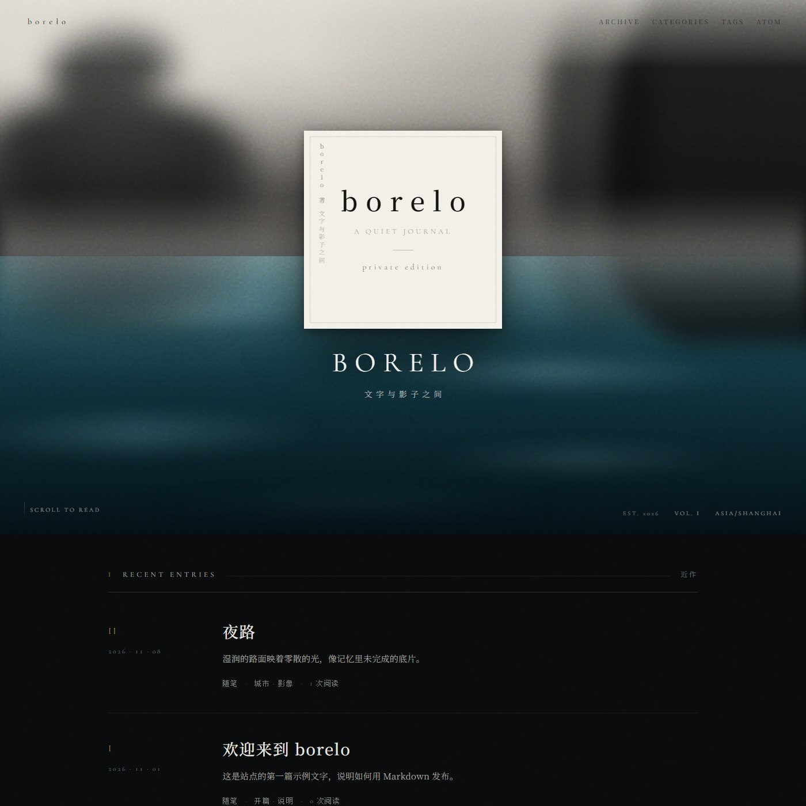
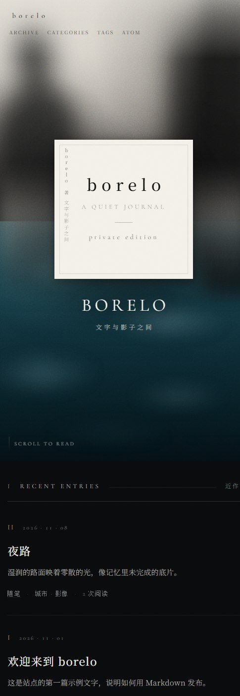
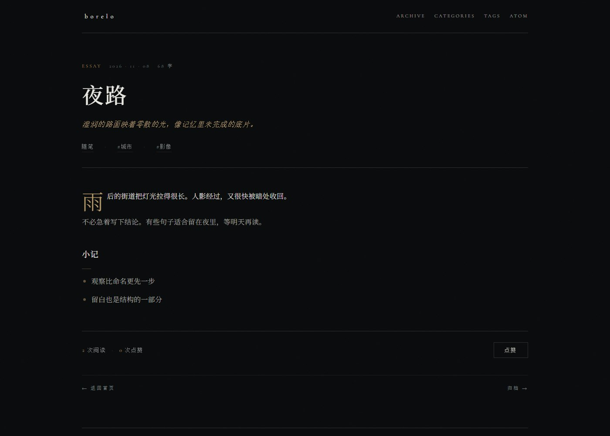

# borelo

一个人的个人博客。Flask 动态渲染 Markdown，SQLite 记录阅读与点赞，Atom 对外订阅；视觉上是深色古典的书封气质 —— 上半雾面人影、下半湿亮夜色，正中一块米白标题板。



<p align="center">
  
  
</p>

## 要求

- Python 3.10+
- Docker / Docker Compose（可选，仅用于 nginx 反代）

## 快速开始

```bash
python -m venv .venv

# Windows
.venv\Scripts\activate
# macOS / Linux
source .venv/bin/activate

pip install -r requirements.txt
flask --app app.wsgi run -p 8000
```

浏览器打开 <http://127.0.0.1:8000>。

生产式启动（gunicorn 仅支持类 Unix 系统）：

```bash
gunicorn -b 127.0.0.1:8000 app.wsgi:app
```

若要用 nginx 反代到 80 端口：

```bash
# 先在本机启动 gunicorn（如上）
docker compose up -d
```

访问 <http://localhost/>。nginx 将请求转发到宿主机 `8000` 端口。

## 写文章

在 `content/` 下新增 `.md` 文件，文件名（不含扩展名）即文章 slug。例如 `2026-11-08-night-walk.md` 对应 `/post/2026-11-08-night-walk/`。

```yaml
---
title: 标题
date: 2026-11-09
categories:
  - 随笔
tags:
  - 示例
summary: 可选摘要
---

正文用 Markdown 写。
```

- `title` 缺省时回退为文件名
- `date` 支持 `YYYY-MM-DD`，缺省为当天
- `categories` / `tags` 支持 YAML 列表或逗号分隔字符串
- `summary` 缺省时自动截取正文前 120 字（见 `config.SUMMARY_LENGTH`）

文章按日期倒序；修改或新增后刷新页面即可，无需重建静态站。应用会比对 `content/` 下最新的文件 mtime，变了才重新解析。

## 站点配置

编辑根目录 `config.py`：

| 项 | 说明 |
|---|---|
| `SITE_NAME` / `SITE_AUTHOR` | 站名与作者，出现在标题板与页脚 |
| `SITE_DESCRIPTION` | 副标题，`文字与影子之间` |
| `SITE_TAGLINE` / `SITE_EDITION` | 标题板内的两行拉丁文 |
| `SITE_LAUNCHED` | 上线日期，用于页脚「运行 N 天」 |
| `SITE_TIMEZONE` | 仅用于封面页脚展示 |
| `BASE_URL` | **上线前必须改**。Atom 里的绝对链接依赖它 |
| `HOME_POST_LIMIT` | 首页显示篇数 |
| `SUMMARY_LENGTH` | 自动摘要长度 |

`BASE_URL` 目前是 `http://localhost`，直接部署会让订阅器拿到本机地址。

## 主要路由

| 路径 | 说明 |
|------|------|
| `/` | 首页（书封 + 近作） |
| `/post/<slug>/` | 文章 |
| `/archive/` | 归档，按年月分组 |
| `/categories/`、`/category/<name>/` | 分类 |
| `/tags/`、`/tag/<name>/` | 标签 |
| `/feed.atom` | Atom 订阅 |
| `/api/view/<slug>` | 记一次阅读（POST） |
| `/api/like/<slug>` | 记一次点赞（POST） |
| `/api/metrics/<slug>` | 读取当前计数 |

## 数据

- 文章：仅 `content/*.md`，不进数据库
- 阅读 / 点赞：`data/blog.sqlite`，启动时自动建表，已 gitignore
- 备份：复制 `data/blog.sqlite`
- 重置计数：删除该文件后重启应用

## 视觉与实现

视觉参考书籍封面的分屏构图，全部由 CSS 渐变、径向光斑与模糊生成 —— **没有任何位图素材**。

- **上半部**：灰白雾面，失焦的头肩轮廓与右缘的深色柱状人影
- **下半部**：深青绿湿亮街面，横向模糊的灯光反射
- **正中**：米白标题板，内嵌细边框，左侧竖排作者与短句
- **纹理**：两层 SVG 噪点（`fractalNoise`）叠加，站点级一层、封面一层

相关文件：

- `static/css/main.css` —— 全部样式，按区块注释组织
- `templates/index.html` —— 封面与近作列表
- `templates/post.html` —— 文章页

封面高度用 `min(100svh, 58rem)` 封顶。不设上限的话，在超长视口下雾面与人影会被拉伸成无法辨认的色块。

### 可访问性

- 动画均遵循 `prefers-reduced-motion`
- 焦点态统一为一像素黄铜色描边
- 封面顶部的深色导航压在一层浅色雾罩上，保证在右侧深色人影上仍然可读

## 已知取舍

- **`/feed.atom` 的 Jinja 自动转义是关闭的**（Flask 只对 `.html/.htm/.xml/.xhtml/.svg` 自动开启）。模板里每个变量都显式写了 `| e`，改动该文件时务必保持。漏一个，标题里的 `&` 或 `<` 就会产出非法 XML。
- 阅读数每次刷新 +1，点赞只靠 localStorage 去重，两个计数都能被脚本刷高。对公开博客的计数够用，但不适合当作严肃指标。
- 页脚统计会在每次渲染时查一次 SQLite，包括 404 页。

## 目录结构

```
app/
  __init__.py        应用工厂、罗马数字过滤器
  db.py              SQLite 连接与建表
  wsgi.py            gunicorn 入口
  routes/
    pages.py         HTML 页面
    api.py           JSON 计数接口
    feed.py          Atom
  services/
    posts.py         扫描解析 Markdown、缓存、字数统计
    metrics.py       阅读与点赞读写
    stats.py         站点汇总统计
config.py            站点配置
content/             Markdown 文章
data/                SQLite（gitignore）
docs/                预览图
templates/           Jinja 模板
static/              CSS 与 JS
nginx/               反代配置
mocks/               早期设计稿，仅作留档
```
