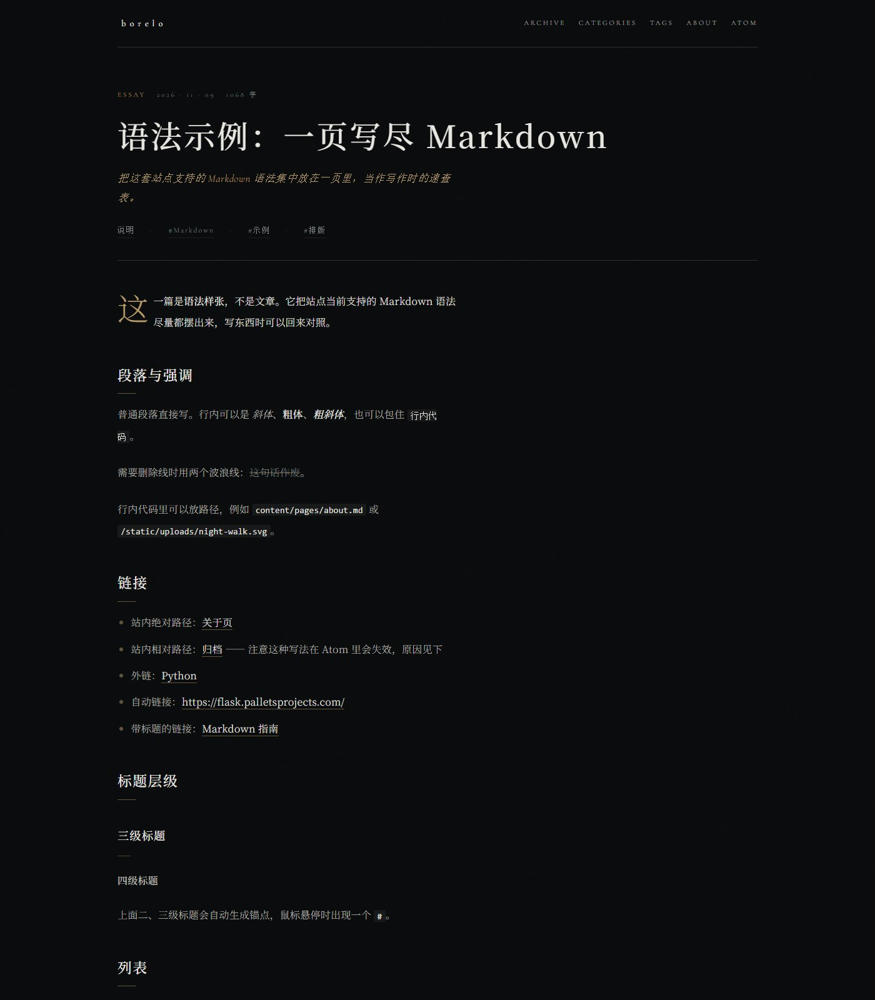

# borelo

一个人的个人博客。Flask 动态渲染 Markdown，SQLite 记录阅读与点赞，Atom 对外订阅；视觉上是深色古典的书封气质 —— 上半雾面人影、下半湿亮夜色，正中一块米白标题板。


<p align="center">
  
  
</p>



## 要求

- Python 3.10+
- Docker / Docker Compose（可选，仅用于 nginx 反代）

## 快速开始

```bash
python -m venv .venv

# Windows
.venv\Scripts\activate
# macOS / Linux
source .venv/bin/activate

pip install -r requirements.txt
flask --app app.wsgi run -p 8000
```

浏览器打开 <http://127.0.0.1:8000>。

生产式启动（gunicorn 仅支持类 Unix 系统）：

```bash
gunicorn -b 127.0.0.1:8000 app.wsgi:app
```

Windows 上没有 gunicorn（它依赖 `fcntl`），用 waitress：

```powershell
pip install waitress
waitress-serve --listen=127.0.0.1:8000 app.wsgi:app
```

若要用 nginx 反代到 80 端口：

```bash
# 先在本机启动 gunicorn / waitress（如上）
docker compose up -d
```

访问 <http://localhost/>。nginx 将请求转发到宿主机 `8000` 端口。

### nginx 与静态资源

`nginx/default.conf` 除了反代，还直接接管了 `static/`：

| 路径 | 处理方式 | 缓存 |
|---|---|---|
| `/static/uploads/` | nginx 从磁盘直接返回 | 7 天 |
| `/static/` | nginx 从磁盘直接返回 | 1 天 |
| 其余 | 反代到 `host.docker.internal:8000` | — |

这样每张图片不必绕经 Python；`docker-compose.yml` 把 `./static` 只读挂载到容器内的 `/srv/static`，`alias` 指向那里。文件不存在时 `try_files` 回落到 Flask，所以新增的 CSS 不会被缓存住。

> 注意：`alias` 是**容器内**路径。若你改了挂载点，`default.conf` 里的 `/srv/static` 也要一起改。

## 写文章

在 `content/` 下新增 `.md` 文件，文件名（不含扩展名）即文章 slug。例如 `2026-11-08-night-walk.md` 对应 `/post/2026-11-08-night-walk/`。

```yaml
---
title: 标题
date: 2026-11-09 21:40
categories:
  - 随笔
tags:
  - 示例
summary: 可选摘要
---

正文用 Markdown 写。
```

- `title` 缺省时回退为文件名
- `date` 支持 `YYYY-MM-DD` 或 `YYYY-MM-DD HH:MM`，按 `config.SITE_TIMEZONE` 解释。缺省时回退为文件修改时间
- `categories` / `tags` 支持 YAML 列表或逗号分隔字符串
- `summary` 缺省时自动截取正文前 120 字（见 `config.SUMMARY_LENGTH`）

文章按发布时间倒序；同一天的多篇按分钟精确保序。修改或新增后刷新页面即可，无需重建静态站。应用会比对 `content/` 下最新的文件 mtime，变了才重新解析。

### 时间与时区

- **发布时间**取自 frontmatter 的 `date`，精确到分钟
- **修改时间**取自文件 mtime，frontmatter 里写任何值都不会影响它
- 两者都按 `config.SITE_TIMEZONE` 表达，Atom 里输出带偏移量的 RFC 3339，例如 `2026-11-09T21:40:00+08:00`
- 时区数据来自 `tzdata` 包。**Windows 不自带 tz 数据库**，缺了它 `zoneinfo` 会抛 `ZoneInfoNotFoundError`，所以它进了 `requirements.txt`

### 在文章里引用图片与文件

图片放在 `static/uploads/`，正文用站内绝对路径引用：

```markdown

```

- 浏览器里保持原样，Flask 直接从 `static/` 提供
- Atom 里会自动补成绝对地址（前缀 `config.BASE_URL`），否则订阅器会按自己的域名解析
- 想让图片也走 nginx、不经过 Python，见下一节；`docker-compose.yml` 已把 `./static` 只读挂载进容器

引用其他文件（PDF、附件等）同理，用 `<a>` 或 Markdown 链接指向 `/static/uploads/…`。

HTML 页面里也可以用相对路径（如 `uploads/x.png`），但要记住它在 feed 里会被解析成错误地址 —— 站内引用统一写以 `/` 开头最稳。

> ⚠️ 上线前务必把 `config.BASE_URL` 从 `http://localhost` 改掉，否则 feed 里的图片和文章链接全是本机地址。

## 站点配置

编辑根目录 `config.py`：

| 项 | 说明 |
|---|---|
| `SITE_NAME` / `SITE_AUTHOR` | 站名与作者，出现在标题板与页脚 |
| `SITE_DESCRIPTION` | 副标题，`文字与影子之间` |
| `SITE_TAGLINE` / `SITE_EDITION` | 标题板内的两行拉丁文 |
| `SITE_LAUNCHED` | 上线日期，用于页脚「运行 N 天」 |
| `SITE_TIMEZONE` | 仅用于封面页脚展示 |
| `BASE_URL` | **上线前必须改**。Atom 里的绝对链接依赖它 |
| `HOME_POST_LIMIT` | 首页显示篇数 |
| `SUMMARY_LENGTH` | 自动摘要长度 |

`BASE_URL` 目前是 `http://localhost`，直接部署会让订阅器拿到本机地址。

## 主要路由

| 路径 | 说明 |
|------|------|
| `/` | 首页（书封 + 近作） |
| `/post/<slug>/` | 文章 |
| `/about/` | 关于页，内容取自 `content/pages/about.md` |
| `/archive/` | 归档，按年月分组 |
| `/categories/`、`/category/<name>/` | 分类 |
| `/tags/`、`/tag/<name>/` | 标签 |
| `/feed.atom` | Atom 订阅 |
| `/api/view/<slug>` | 记一次阅读（POST） |
| `/api/like/<slug>` | 记一次点赞（POST） |
| `/api/metrics/<slug>` | 读取当前计数 |

## 关于页

`/about/` 是一个独立的 Markdown 页面，与文章流分开：

```
content/pages/about.md
```

放在 `content/pages/` 而非 `content/` 根下，是因为文章加载器只扫描 `content/*.md`，子目录里的文件不会被当成文章列进首页、归档或 Atom。改这个文件后刷新即可，页面的 mtime 缓存会感知到变更。

## 支持的 Markdown 语法

文章与独立页共用 `app/services/markdown_render.py` 里的同一套扩展，因此下面的语法在 `/about/` 与文章里表现一致。

| 能力 | 语法示例 |
|---|---|
| 强调 / 删除线 | `**粗**`、`*斜*`、`~~删~~` |
| 代码块 | ```` ```python ```` |
| 表格 | `\| 列 \| 列 \|`，支持 `:---:` 对齐 |
| 定义列表 | 术语下一行顶格写 `: 解释` |
| 脚注 | `文字[^1]` + `[^1]: 内容` |
| 提示块 | `!!! note "标题"`（支持 `note` / `warning`） |
| 标题锚点 | 二、三级标题自动生成，悬停显示 `#` |
| 行内 HTML | 受信任的 HTML 会原样输出 |
| 属性 | `{ width="240" }` |
| 标点美化 | 直引号转弯引号，`--` 转破折号 |
| 自动链接 | `<https://example.com>` |

完整样张见 `content/2026-11-09-markdown-showcase.md`，它把上述语法集中演示在一页里。

**嵌套列表要用 4 个空格缩进**。Python-Markdown 只认 4 格，2 格会被当作同级，这是最常见的排版踩坑点。

## 数据

- 文章：仅 `content/*.md`，不进数据库
- 阅读 / 点赞：`data/blog.sqlite`，启动时自动建表，已 gitignore
- 备份：复制 `data/blog.sqlite`
- 重置计数：删除该文件后重启应用

## 视觉与实现

视觉参考书籍封面的分屏构图，全部由 CSS 渐变、径向光斑与模糊生成 —— **没有任何位图素材**。

- **上半部**：灰白雾面，失焦的头肩轮廓与右缘的深色柱状人影
- **下半部**：深青绿湿亮街面，横向模糊的灯光反射
- **正中**：米白标题板，内嵌细边框，左侧竖排作者与短句
- **纹理**：两层 SVG 噪点（`fractalNoise`）叠加，站点级一层、封面一层

相关文件：

- `static/css/main.css` —— 全部样式，按区块注释组织
- `static/js/home.js` —— 封面视差与首页条目入场
- `templates/index.html` —— 封面与近作列表
- `templates/post.html` —— 文章页

### 动效

首页有两处动效，都不依赖动画库：

- **封面**：雾面人影缓慢漂浮，街面的灯光反射各自呼吸。这两组是纯 CSS 关键帧，跑在合成器线程上，不占主线程。鼠标移动时，`home.js` 再叠加一层视差 —— 它写的是 `translate` 这个独立属性，而不是覆盖 `transform`，因此能和 CSS 动画叠加而不打架，位移由 `transition` 插值，指针静止时没有任何循环在跑。
- **近作条目**：滚动进入视口时淡入上浮，**每次进入都会重播** —— 条目离开视口后会被重新武装，向上滚回来时再浮动一次。前几条按 80ms 错峰，超出四条不再累加延迟。

两者都遵循 `prefers-reduced-motion`：关闭后动画被压到最短，条目直接可见。

另有 `no-js` 兜底：`<html>` 初始带 `no-js` 类，`<head>` 里的内联脚本立刻移除它。若脚本被禁用，条目不会因为等不到 `.is-visible` 而一直隐形。

封面底部有一道 18rem 的渐变，把湿街的青绿过渡到正文的墨色。没有它，两个近黑色之间会留下一条生硬的横向接缝。

封面高度用 `min(100svh, 58rem)` 封顶。不设上限的话，在超长视口下雾面与人影会被拉伸成无法辨认的色块。

### 可访问性

- 动画均遵循 `prefers-reduced-motion`
- 焦点态统一为一像素黄铜色描边
- 封面顶部的深色导航压在一层浅色雾罩上，保证在右侧深色人影上仍然可读

## 已知取舍

- **`/feed.atom` 的 Jinja 自动转义是关闭的**（Flask 只对 `.html/.htm/.xml/.xhtml/.svg` 自动开启）。模板里每个变量都显式写了 `| e`，改动该文件时务必保持。漏一个，标题里的 `&` 或 `<` 就会产出非法 XML。
- 阅读数每次刷新 +1，点赞只靠 localStorage 去重，两个计数都能被脚本刷高。对公开博客的计数够用，但不适合当作严肃指标。
- 页脚统计会在每次渲染时查一次 SQLite，包括 404 页。
- **页脚的“最后活动”是相对时间**（`今天` / `昨天` / `N 天前`），取发布时间、文件修改时间、以及最后一条阅读/点赞记录三者中最新的一项。所以只要有访客浏览，这个数字就会变成“今天”。
- 文章 `<updated>` 用文件 mtime，因此**重新检出仓库、复制文件或从别的机器同步都会刷新它**，即使内容没变。想保持稳定的话，提交后不要反复触碰文件。

## 目录结构

```
app/
  __init__.py        应用工厂、罗马数字过滤器
  db.py              SQLite 连接与建表
  wsgi.py            gunicorn / waitress 入口
  routes/
    pages.py         HTML 页面
    api.py           JSON 计数接口
    feed.py          Atom
  services/
    posts.py         扫描解析文章、缓存、字数统计
    content_pages.py 独立页（如 about.md）
    markdown_render.py  共用的 Markdown 扩展配置
    times.py         时区与相对时间
    metrics.py       阅读与点赞读写
    stats.py         站点汇总统计
config.py            站点配置
content/
  *.md               文章
  pages/*.md         独立页
data/                SQLite（gitignore）
docs/                预览图
templates/           Jinja 模板
static/
  css/ js/           样式与脚本
  uploads/           文章引用的图片与文件
nginx/               反代与静态资源配置
mocks/               早期设计稿，仅作留档
```
